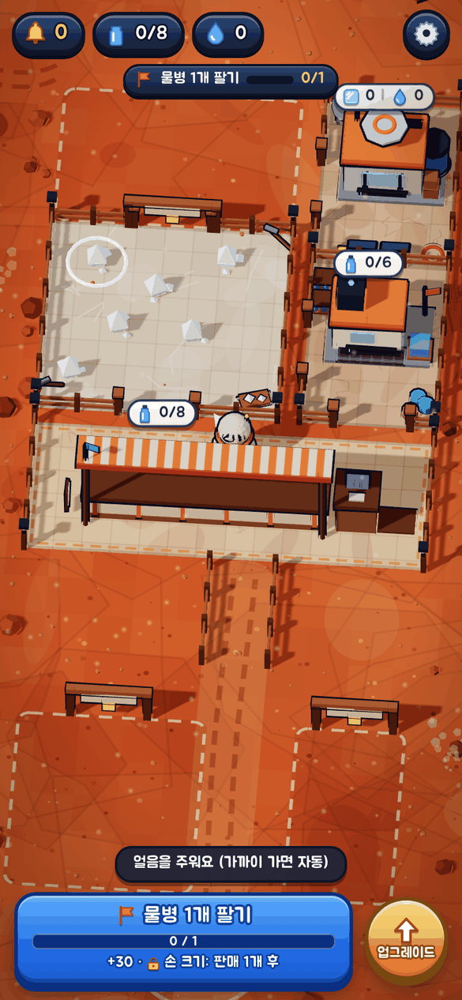
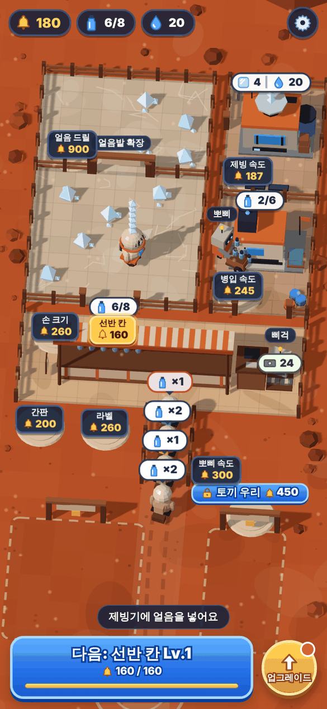
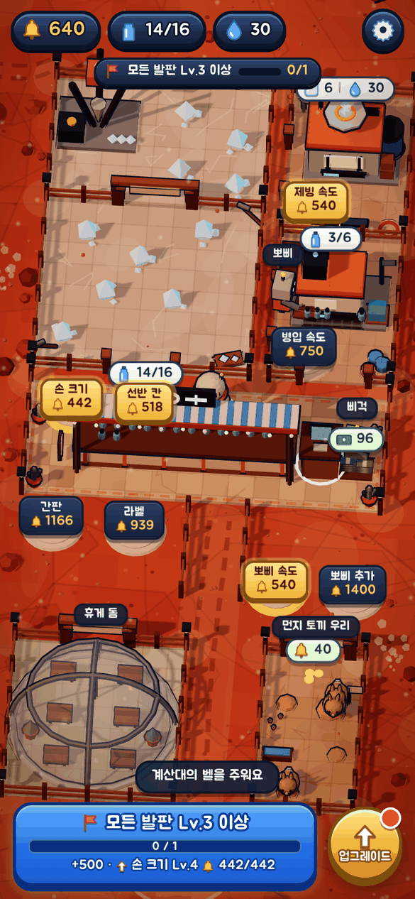

# 화성의 숲

붉은 행성에서 물병 가게를 키우는 피자레디식 타이쿤. 두 가지 버전이 한 저장소에 있다.

| 경로 | 무엇 | 용도 |
|---|---|---|
| `app/index.html` | **화성 물병 가게** (앱용, 세로 전용) | iOS 앱 본체. 피자레디 루프만 남긴 새 설계 |
| `index.html` | 화성의 숲 (웹, 가로·세로 모두) | 녹지화·주민·탈것까지 있는 원본 콜로니 게임 |

둘 다 바닐라 JS + three.js(CDN importmap. 앱 빌드 때는 `vendor/`에 내려받아 번들에 넣어 오프라인 동작), 진행은 localStorage.

## 화성 물병 가게 (app/)

루프: 얼음 줍기 → 제빙기 → 병입기 → 카운터 → 손님 결제 → 벨 → 노란 발판을 밟아(또는 업그레이드 시트에서 탭해서) 업그레이드·고용·구역 확장.

| 시작 | 중반 | 후반 |
|---|---|---|
|  |  |  |

- **비주얼**: 화이트아웃 서바이벌식 디오라마. 나무 판자 울타리로 나뉜 구역(얼음밭·제빙·병입·매장·얼음밭 확장·휴게 돔·먼지 토끼 우리), 잠긴 구역은 점선 테두리와 자물쇠 달린 게이트. 덩어리감 있는 2~3톤 건물과 소품, 떠 있는 자원 카운터(n/max·MAX 배지), 계산대에 쌓이는 지폐 묶음, 손수레 미는 운반 로봇, 떠다니는 먼지와 돌풍, 긴 그림자.
- **조작**: 화면 아무 데나 드래그하면 플로팅 조이스틱. 줍기·넣기·올리기·돈 줍기는 가까이 가면 자동.
- **발판 14종**: 손 크기, 얼음밭 확장(구역), 제빙기·병입기 속도, 선반 칸, 삐걱 고용(계산 자동), 간판(손님↑), 먼지 토끼 우리(구역·가끔 벨), 뽀삐 고용(운반 자동)·속도·추가, 프리미엄 라벨(값↑), 얼음 드릴(채굴 자동), 휴게 돔(구역·팁). 판매량에 따라 순서대로 열린다. 발판 위 가격표에 서 있으면 벨이 들어가고, 하단 업그레이드 버튼의 시트에서도 레벨 핍과 가격을 보고 바로 살 수 있다.
- **하단 배너**: 다음 목표와 진행률을 보여주고, 탭하면 업그레이드 시트가 열린다.
- **부재 중 수익**: 삐걱+뽀삐를 고용한 뒤 앱을 닫아도 최대 2시간치 벨이 쌓인다.
- **연출**: 55° 시점 로우폴리, 걷기 바운스·기울기, 등짐이 이동 방향 반대로 쏠리는 스택, 아이템·동전 아크 비행, 발판 결제 코인, 구역·건물 팝업, 손님 점프, 카운터 펄스.
- **에셋(v3)**: 바위(지평선 바위산·가장자리 돌 34개)·드럼통·휴게 돔의 온실 화단과 분수·날아가는 동전은 Kenney의 CC0 저폴리 모델이다. `assets/models/*.glb`를 `node tools/bake-models.mjs`가 정점색 바이너리로 구워 `app/index.html` 안의 `/*@MODELS*/` 한 줄에 base64로 넣는다(의존성 없음, 30KB). 게임은 `mdl(이름, 크기, 색교체맵)`으로 메시를 만들고 기존 베이크 외곽선 파이프라인에 그대로 태운다. 모델을 바꾸거나 더하려면 GLB를 `assets/models/`에 넣고 `tools/bake-models.mjs`의 `LIST`에 한 줄 추가한 뒤 다시 굽는다(`--stats`로 크기·색 확인). 출처·라이선스는 `assets/models/README.md`.
- **건물(v4)**: 제빙기(소형 격납고 + 물탱크·굴뚝), 병입기(육각 격납고 + 펌프), 착륙선(로켓 파츠 4단), 얼음 드릴(철골 데릭 2단 + 발전기·드럼통), 휴게 돔 바닥(발판 + 에어록), 위성 안테나·로버는 Kenney Space Kit(CC0) 모델이다. 진행 바·발광 코어·컨베이어·깃발·비컨 같은 살아있는 파츠와 외곽선 베이크는 그대로이고, 모델 데이터는 base64 82KB, 드로우콜은 시작 157·후반 259.
- 힌트 화살표가 다음 행동을 가리키므로 튜토리얼이 따로 없다. 저장 키는 그대로(`mars-bottle-v1`)라 이전 진행이 이어진다.
- **게임 손맛 업데이트(v2)**: 그림은 ACES 톤매핑·따뜻한 키라이트·하늘빛 반구광에, 건물·캐릭터·토끼는 정점색으로 베이크한 역면 외곽선과 접지 그림자로 두툼한 툰 느낌. 바닥은 갈라진 판·크레이터·인스턴스 자갈·떠도는 먼지 회오리·비네트, 건물은 제빙기 김과 코어 발광, 병입기 컨베이어(흐르는 벨트 위로 병이 이동), 흔들리는 차양, 계산대 화면 발광, 도는 안테나, 태양광 반짝임으로 살아 움직인다. 5분 주기 낮밤(정오→노을→밤→새벽)에 울타리 모서리 가로등과 창문이 켜진다. 손맛은 판매·발판 완료·구역 해제의 카메라 흔들림, HUD 숫자 펀치, 벨 줍기 때 HUD로 날아가는 동전(음 높이 상승), 튀는 +N, 줍기·놓기 스쿼시, 큰 판매·VIP 색종이, 발판 충전 틱 소리와 완료 딩·플래시, 모든 버튼 눌림(0.93)과 클릭음, 2초 안 3판매 이상 콤보(×5까지 +10%/단계), 레이어드 신스 효과음과 아주 조용한 바람 루프, `navigator.vibrate`. 콘텐츠는 30단계 순차 목표(완료 때 보물 상자 연출과 벨 보상, 저장 `S.quest`/`S.qc`), 판매 20개 뒤 12번째마다 오는 금색 VIP(×3 + 팁), 삐걱 고용 뒤 4분마다 20초 손님 러시, 장식 상점 6종(차양 색·간판 네온·화분·줄전구·깃발 색·타일 무늬, `S.deco`), 모든 시설 MAX 뒤 "새 기지로 이주"(가격 ×1.5 영구, 장식 유지). UI는 Jua 글꼴, 베벨 패널·3px 테두리·눌림 상태, 하단은 목표 미션바(진행률 + 다음 업그레이드), 시트는 업그레이드/장식/목표 탭, 타이틀 화면(행성·로고·펄스 시작 버튼)과 같은 결의 설정·보물 상자·부재 중 수익 모달. 드로우콜은 시작 150, 후반 265~290(이전 194/396).

## iOS 앱

`ios/`에 WKWebView 래퍼. `app/index.html`과 three.js(빌드 때 내려받음)를 번들에 넣고 `mars://app/` 커스텀 스킴으로 서빙한다(ES 모듈·localStorage 안정). 세로 고정, 상태바 숨김.

```bash
cd ios
./build.sh          # 시뮬레이터 빌드 → 켜져 있는 시뮬레이터에 설치·실행
./build.sh xcode    # Xcode 프로젝트 생성·열기 (실기기 서명·설치)
```

요구: Xcode, `brew install xcodegen`. 구조는 hanjul·menubar-pets와 같다(`project.yml` + `build.sh`). `ios/App/Web/`은 build.sh가 매번 만드는 산출물이라 git에 없다.

## 웹 버전 (index.html) 조작

| | 데스크톱 | 폰 |
|---|---|---|
| 이동 | 방향키·WASD 또는 땅 클릭 | 드래그(플로팅 조이스틱) 또는 땅 탭 |
| 행동 | Space 또는 대상 클릭 | 대상 탭 또는 행동 버튼 · 얼음·돌은 근접 자동 채집 |
| 카메라 | 드래그, 휠 | 두 손가락 핀치 |
